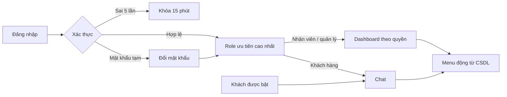

# Honda AI Portal · Flask + MariaDB/MySQL

Hệ thống Trợ lý AI - Đại lý xe máy Honda. Dữ liệu mô phỏng phục vụ thử nghiệm.

Logo cục bộ lấy từ `docs/images/logo.jpg`, phục vụ qua `static/images/logo.jpg` trên trang đăng nhập và thanh đầu trang. Câu trả lời chat hiển thị chữ **đậm**, *nghiêng* và danh sách bằng DOM an toàn, không hiện dấu Markdown tương ứng. Quy ước source và nội dung sinh mới: dùng dấu `-` thay cho dấu gạch dài. Backend chuẩn hóa trước khi lưu câu trả lời; frontend chuẩn hóa văn bản nguồn và ô dữ liệu cũ.

Tài khoản website nằm trong bảng `honda_chatbot.users`, quản lý ở `/admin/users` với quyền `user:manage`. Tài khoản kết nối MySQL trong `.env` là một loại tài khoản riêng. Xem [hướng dẫn tài khoản và source](docs/account_management.md). Kiểm tra kết nối và số dòng bằng `python check_db.py`.

## Cài đặt và cấu hình

Python 3.13+, MariaDB 10.4.32 (đã kiểm chứng) hoặc MySQL 8.0.16+.

```powershell
python -m pip install -r requirements.txt
```

Tạo `.env` theo `.env.example`. Không commit bí mật.

- `DB_HOST`, `DB_PORT`, `DB_NAME=honda_chatbot`: địa chỉ database.
- `DB_USER=admin_nt`, `DB_PASSWORD`: tài khoản ứng dụng. `APP_DB_PASSWORD` phải trùng `DB_PASSWORD`. Script khởi tạo tạo/cập nhật đúng tài khoản `DB_USER`, chỉ cấp SELECT/INSERT/UPDATE/DELETE.
- `ADMIN_DB_USER`, `ADMIN_DB_PASSWORD`: tài khoản có quyền khởi tạo schema/user, chỉ dùng bởi `init_db.py`.
- `CHATBOT_RO_USER=chatbot_ro`, `CHATBOT_RO_PASSWORD`: tài khoản SQL chatbot, chỉ đọc view AI.
- `DEMO_ACCOUNT_PASSWORD`: mật khẩu chung cho demo id 1–9, ít nhất 10 ký tự, không hiển thị trên UI/log. Xem giá trị cục bộ trong `.env`.
- `FLASK_SECRET_KEY`: khóa phiên ngẫu nhiên đủ dài.
- `APP_ENV=dev`: cookie dev trên HTTP; production dùng cookie Secure và cần HTTPS.
- `ALLOW_GUEST_CHAT=true`: cho phép nút vào chat công khai. Đặt false để tắt.
- `GROQ_API_KEY`, `GROQ_MODEL=openai/gpt-oss-20b`: khóa thật và model; không cần khóa để chạy các test cục bộ.

### Cấu hình máy của thành viên nhóm

Mỗi máy cài MySQL/MariaDB, cài dependencies rồi sao chép `.env.example` thành `.env`. Đặt `DB_USER=admin_nt`, điền mật khẩu nhóm đã thống nhất vào cả `DB_PASSWORD` và `APP_DB_PASSWORD`. Điền `ADMIN_DB_USER`/`ADMIN_DB_PASSWORD` theo tài khoản quản trị MySQL thực tế của máy đó; không mặc định các máy có cùng mật khẩu root. Điền đầy đủ các biến bí mật còn lại, gồm mật khẩu chatbot, demo và khóa phiên. `.env` được Git bỏ qua; trao đổi bí mật riêng, không đưa vào source.

```powershell
python init_db.py --create-if-missing
python check_db.py
python app.py
```

Nếu database đã tồn tại và chỉ cần cập nhật tài khoản kết nối, chạy `python init_db.py --extensions-only`, rồi khởi động lại ứng dụng. Không dùng `--reset` để đổi mật khẩu vì lệnh này xóa dữ liệu.

`DB_HOST=127.0.0.1` nghĩa là mỗi máy dùng database riêng. Cùng source và cùng tài khoản không tự đồng bộ dữ liệu. Muốn dữ liệu thay đổi được chia sẻ ngay, cần một MySQL dùng chung: đặt cùng `DB_HOST` trỏ tới máy chủ đó, quản trị viên cấp quyền kết nối cho đúng địa chỉ máy backend và cấu hình mạng/firewall. Script hiện tạo tài khoản `localhost`, phù hợp chạy backend và MySQL trên cùng máy; không tự mở MySQL ra mạng. Khi chạy test có thay đổi dữ liệu, dùng database phát triển riêng.

### Dùng máy chủ của nhóm trong LAN

Máy chủ hiện tại: `192.168.10.160:3306`, mạng `192.168.10.0/24` (IP có thể đổi khi chuyển Wi-Fi; nên đặt DHCP reservation trên router). Giữ `DB_HOST=127.0.0.1` trong `.env` máy chủ. Sau khi khởi tạo, cấp tài khoản cho LAN bằng:

```powershell
python scripts/configure_shared_mysql.py --network 192.168.10.0/24
```

Script chạy lại được, cập nhật mật khẩu từ `.env`, cấp quyền ứng dụng và quyền đọc view riêng cho chatbot. Khi đổi mật khẩu, chạy lại cả `init_db.py --extensions-only` và script trên để cập nhật tài khoản local/LAN.

Máy bạn cùng mạng Wi-Fi/LAN đặt `DB_HOST=192.168.10.160`, `DB_PORT=3306`, `DB_NAME=honda_chatbot`, `DB_USER=admin_nt`, điền mật khẩu nhóm vào `DB_PASSWORD` và `APP_DB_PASSWORD`. Nhận riêng `CHATBOT_RO_PASSWORD` và `DEMO_ACCOUNT_PASSWORD` từ máy chủ; tự tạo `FLASK_SECRET_KEY` cục bộ. Không chia sẻ tài khoản quản trị MySQL. Chỉ chạy `python check_db.py` rồi `python app.py` trên máy bạn; mọi lệnh khởi tạo/migration/reset chỉ chạy trên máy chủ. Khởi động lại backend sau khi sửa `.env`.

MySQL máy chủ phải lắng nghe địa chỉ LAN. Nếu Windows Firewall chặn, mở PowerShell quản trị trên máy chủ và thêm quy tắc giới hạn LAN:

```powershell
New-NetFirewallRule -DisplayName 'MySQL nhom de tai LAN' -Direction Inbound -Action Allow -Protocol TCP -LocalAddress 192.168.10.160 -LocalPort 3306 -RemoteAddress 192.168.10.0/24 -Profile Private
```

Quy tắc mẫu chỉ áp dụng mạng Private. Wi-Fi hiện đang là Public; chưa có quy tắc mới được tạo. Cần chủ máy xác nhận đây là LAN tin cậy và quyết định cấu hình profile/quy tắc trước khi mở kết nối từ máy khác.

Máy chủ cần bật và MySQL đang chạy. Từ máy bạn kiểm tra `Test-NetConnection 192.168.10.160 -Port 3306`; sau đó `python check_db.py`. Ngoài LAN cần VPN hoặc máy chủ được triển khai riêng; không chuyển tiếp cổng MySQL ra Internet. `admin_nt` là tài khoản kết nối database; đăng nhập website vẫn dùng email và mật khẩu trong `users`.

## Khởi tạo và chạy

```powershell
python init_db.py --create-if-missing
python app.py
```

Truy cập **http://127.0.0.1:5000/login**. Nếu đã có dữ liệu:

```powershell
python init_db.py --extensions-only
```

`schema_migrations` ghi file đã áp dụng và bỏ qua ở lần sau. Extension xác thực là `06_auth_dynamic_rbac.sql` vì số 05 đã được dùng cho thông số sản phẩm. `07_own_scope_views.sql` thêm lọc bản ghi sở hữu cho chatbot.

```powershell
python init_db.py --reset
```

Lệnh reset xóa và tái tạo riêng `honda_chatbot`; chỉ chạy khi chủ động muốn khởi tạo lại bộ dữ liệu mô phỏng. Khi reset, migration và mật khẩu demo được áp dụng lại. Có thể chủ động đặt lại mật khẩu demo bằng `python scripts/seed_demo_passwords.py`; script dừng nếu thiếu biến cấu hình.

Ứng dụng chỉ có SELECT/INSERT/UPDATE/DELETE trên database. `chatbot_ro` có SELECT view AI và EXECUTE các hàm scope. Root chỉ nằm trong cấu hình khởi tạo. Schema chuẩn không bị sửa.

## Tài khoản demo

Mật khẩu lấy từ `DEMO_ACCOUNT_PASSWORD` trong `.env`, không viết ở đây.

| ID | Email | Vai trò | Landing / phạm vi |
|---|---|---|---|
| 1 | admin@honda-nt.example | super_admin | Dashboard / toàn hệ thống |
| 2 | minh.nv@honda-nt.example | branch_manager | Dashboard / NT01 |
| 3 | lan.tt@honda-nt.example | sales_staff | Dashboard / NT01 |
| 4 | bao.lq@honda-nt.example | sales_staff | Dashboard / NT02 |
| 5 | hung.pv@honda-nt.example | technician | Dashboard / NT01, không doanh thu |
| 6 | hoa.vt@honda-nt.example | accountant | Dashboard / toàn hệ thống, tài chính |
| 7 | mkt@honda-nt.example | marketing | Dashboard / theo quyền hiện có |
| 8 | mai.nt@example.com | customer | Chat / bản ghi sở hữu |
| 9 | nam.tv@example.com | customer | Chat / bản ghi sở hữu |

Khách id 101–180 giữ hash giả và không đăng nhập được. Không còn ô chọn tài khoản hoặc header giả danh trong sản phẩm.



## Quyền và quản trị

- Quyền được tính từ `v_user_permissions` mỗi request: loại user/role không hoạt động và assignment hết hạn. `all` thắng `branch` thắng `own`.
- Scope branch dùng assignment, rồi home branch; thiếu branch thì từ chối. Không hỗ trợ nhiều chi nhánh giới hạn cùng lúc.
- `/admin/users`: tạo tài khoản, mật khẩu tạm, khóa/mở khóa, reset password, gán/gỡ role và ngày hết hạn.
- `/admin/roles`: tạo/nhân bản role, ma trận quyền và scope; không xóa/đổi tên role hệ thống. super_admin cố định và luôn có tất cả quyền.
- `/admin/permissions`: chỉnh mô tả, không thay mã quyền.
- `/admin/audit`: nhật ký RBAC và chatbot, lọc người thực hiện/hành động/thời gian/kết quả.
- Mỗi thay đổi được serialize bằng khóa `rbac_meta`, transaction, audit before/after và tăng version; rollback nếu vi phạm bảo vệ admin cuối cùng hoặc tự khóa/gỡ quyền.
- Quản trị RBAC là cấu hình toàn hệ thống nên `rbac:manage` phải scope all; branch/own bị từ chối. Quản trị tài khoản và audit hỗ trợ scope tương ứng; người quản trị được ủy quyền không gán được quyền rộng hơn của mình.

Các form và fetch ghi cần CSRF. Đăng nhập xóa phiên cũ, cookie HttpOnly/SameSite=Lax, có CSP chỉ tài nguyên cục bộ và header bảo mật. Chart.js 4.4.8 đặt tại `static/vendor/`, giấy phép MIT trong header nguồn.

## Chat và các module

Chat giữ validator AST, LIMIT tối đa 100, timeout, whitelist theo intent/quyền và user MySQL riêng. Câu phổ biến dùng SQL tham số hóa; câu nâng cao dùng Groq tạo SQL rồi bind literal theo thứ tự. Giá và số liệu SQL được render chính xác bằng bảng, không để model viết lại chữ số. RAG chỉ lấy tài liệu được phép và hiển thị nguồn.

Ví dụ: “giá Vario 160”, “thông tin SH Mode 125”, “xe ga dưới 50 triệu”, “so sánh Vision và Lead”. Sales hỏi tồn kho chỉ thấy chi nhánh được cấp. Thiếu dữ liệu hoặc quyền thì không bịa và không xác nhận dữ liệu riêng có tồn tại.

Khách hàng và tồn kho có tìm kiếm, lọc, phân trang và sắp xếp. Opportunity, Quote, Booking giữ trạng thái **Sắp có** và HTTP 501, chưa tự tạo schema.

## Kiểm thử

```powershell
python init_db.py --reset
python init_db.py --reset
python -m pytest -q
```

Test MySQL dùng database thật; thiếu database/schema là lỗi, không tự skip. Test Groq tự skip khi không có khóa. Các test API đăng nhập qua test client và gửi CSRF thật, không gán user_id trực tiếp vào phiên.

Kết quả, bảng route/quyền/scope, ảnh giao diện và giới hạn được ghi trong [docs/test_results.md](docs/test_results.md).

### Kiểm tra chat và bố cục

Chat nhận câu hỏi tồn kho như “SH 160 chi nhánh nào còn?”, giữ mẫu xe cho câu tiếp “chi nhánh nào còn?”, và vẫn kiểm tra quyền mỗi lượt. So sánh mẫu xe thiếu dữ liệu sẽ nêu rõ mẫu còn thiếu, không tự đổi dung tích. Kết quả SQL có lời giải thích cùng bảng; cột mẫu xe/phiên bản đứng trước, bảng rộng cuộn ngang, lịch sử dài cuộn dọc mà không ép thấp tin nhắn.

```powershell
python -m pytest -q tests/test_chat_understanding.py tests/test_db_pool.py
```

Test trình duyệt tùy chọn nằm trong `tests/test_chat_layout.py`. Cài `playwright` vào môi trường phát triển; test dùng Edge có sẵn trên Windows hoặc Chromium của Playwright (`python -m playwright install chromium`). Test chạy backend cục bộ tạm thời, đăng nhập qua form thật, kiểm tra sáu lượt hỏi trên màn hình 1440×900, 1280×600 và 390×844; ảnh nằm trong `.pytest_cache/chat-layout/`. Không cài Playwright thì riêng module này được skip, các test MySQL vẫn chạy.

```powershell
python -m pip install playwright
python -m pytest -q tests/test_chat_layout.py
```
