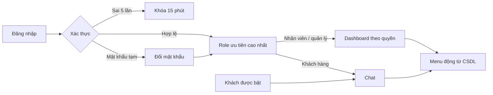

# Honda AI Portal · Flask + MariaDB/MySQL

Hệ thống Trợ lý AI - Đại lý xe máy Honda. Dữ liệu mô phỏng phục vụ thử nghiệm.

Logo cục bộ lấy từ `docs/images/logo.jpg`, phục vụ qua `static/images/logo.jpg` trên trang đăng nhập và thanh đầu trang. Câu trả lời chat hiển thị chữ **đậm**, *nghiêng* và danh sách bằng DOM an toàn, không hiện dấu Markdown tương ứng. Quy ước source và nội dung sinh mới: dùng dấu `-` thay cho dấu gạch dài. Backend chuẩn hóa trước khi lưu câu trả lời; frontend chuẩn hóa văn bản nguồn và ô dữ liệu cũ.

Tài khoản website nằm trong bảng `honda_chatbot.users`, quản lý ở `/admin/users` với quyền `user:manage`. Tài khoản kết nối MySQL trong `.env` là một loại tài khoản riêng. Xem [hướng dẫn tài khoản và source](docs/account_management.md). Kiểm tra kết nối và số dòng bằng `python check_db.py`.

## Cài đặt và cấu hình

Python 3.13+, MariaDB 10.4.32 (đã kiểm chứng) hoặc MySQL 8.0.16+.

```powershell
python -m pip install -r requirements.txt
```

Tạo `.env` theo `.env.example`. Không commit bí mật.

- `DB_HOST`, `DB_PORT`, `DB_NAME=honda_chatbot`: địa chỉ database.
- `DB_USER=admin_nt`, `DB_PASSWORD`: tài khoản ứng dụng. `APP_DB_PASSWORD` phải trùng `DB_PASSWORD`. Script khởi tạo tạo/cập nhật đúng tài khoản `DB_USER`, chỉ cấp SELECT/INSERT/UPDATE/DELETE.
- `ADMIN_DB_USER`, `ADMIN_DB_PASSWORD`: tài khoản có quyền khởi tạo schema/user, chỉ dùng bởi `init_db.py`.
- `CHATBOT_RO_USER=chatbot_ro`, `CHATBOT_RO_PASSWORD`: tài khoản SQL chatbot, chỉ đọc view AI.
- `DEMO_ACCOUNT_PASSWORD`: mật khẩu chung cho demo id 1–9, ít nhất 10 ký tự, không hiển thị trên UI/log. Xem giá trị cục bộ trong `.env`.
- `FLASK_SECRET_KEY`: khóa phiên ngẫu nhiên đủ dài.
- `APP_ENV=dev`: cookie dev trên HTTP; production dùng cookie Secure và cần HTTPS.
- `ALLOW_GUEST_CHAT=true`: cho phép nút vào chat công khai. Đặt false để tắt.
- `GROQ_API_KEY`, `GROQ_MODEL=openai/gpt-oss-20b`: khóa thật và model; không cần khóa để chạy các test cục bộ.

### Dùng chung một MySQL trong LAN

Các máy phải kết nối **cùng một máy chủ MySQL**. `DB_HOST=127.0.0.1` trên từng máy tạo các database độc lập; Git, file SQL và Excel không tự đồng bộ MySQL. Khi dùng chung máy chủ, giao dịch đã commit được các máy đọc ở lần truy vấn tiếp theo; tải lại trang để cập nhật giao diện. Không cần import/reset trên máy thành viên.

Máy chủ giữ `.env` với `DB_HOST=127.0.0.1` và credential quản trị riêng. Chỉ máy chủ chạy:

```powershell
python init_db.py --extensions-only
ipconfig
```

Nếu chưa có database, dùng `--create-if-missing`. Lấy IPv4 và subnet thực tế của adapter LAN/Wi-Fi, không dùng IP cũ từ README. Ví dụ kiểm tra ngày **21/10/2026**: máy chủ `192.168.100.187:3306`, mạng `192.168.100.0/24`. Trên máy chủ:

```powershell
python scripts/configure_shared_mysql.py --network 192.168.100.0/24
```

Script tạo/cập nhật tài khoản ứng dụng và chatbot riêng cho mạng đã chỉ định, không cấp quyền quản trị, không đổi dữ liệu nghiệp vụ. Chỉ nhận mạng IPv4 RFC1918 /24 hoặc nhỏ hơn. Khi đổi mật khẩu, chạy lại cả `init_db.py --extensions-only` và `configure_shared_mysql.py`. Khởi động lại các backend để tạo lại connection pool.

MySQL phải lắng nghe trên IP LAN. Nếu firewall chưa cho phép, mở PowerShell quản trị trên máy chủ và chạy với đúng địa chỉ/mạng:

```powershell
powershell -NoProfile -ExecutionPolicy Bypass -File scripts/allow_mysql_lan.ps1 -Network 192.168.100.0/24 -ServerAddress 192.168.100.187
```

Quy tắc giới hạn TCP 3306 từ mạng đã chọn tới IPv4 máy chủ đã chọn; áp dụng Private/Public để không phụ thuộc profile Wi-Fi. Script không thay đổi các quy tắc firewall khác. Chỉ dùng trên LAN tin cậy; không chuyển tiếp cổng MySQL ra Internet. Nên đặt DHCP reservation để IP máy chủ ổn định. Nếu đổi mạng, chạy lại script với subnet/IP mới.

Trên **máy thành viên**, sao chép `.env.example` thành `.env` và đặt:

```dotenv
DB_HOST=192.168.100.187
DB_PORT=3306
DB_NAME=honda_chatbot
DB_USER=admin_nt
```

Điền riêng `DB_PASSWORD`/`APP_DB_PASSWORD` và `CHATBOT_RO_PASSWORD` khớp máy chủ. Giữ `CHATBOT_RO_USER=chatbot_ro`. Tự tạo `FLASK_SECRET_KEY` riêng; đặt `APP_ENV=dev` khi chạy HTTP cục bộ. Xóa `ADMIN_DB_USER`/`ADMIN_DB_PASSWORD` trên máy thành viên, không chia sẻ credential quản trị. Mật khẩu website là mật khẩu trong bảng `users` trên máy chủ; `DEMO_ACCOUNT_PASSWORD` chỉ dùng seed/kiểm thử, không tự thay mật khẩu đăng nhập.

```powershell
Test-NetConnection 192.168.100.187 -Port 3306
python scripts/check_shared_mysql.py
python app.py
```

Công cụ kiểm tra in máy đích, tên máy chủ thực tế, account được MySQL chọn, migration còn thiếu và kiểm tra chatbot đọc view/hàm scope nhưng không đọc được bảng gốc. Có thể thử IP khác mà không sửa `.env` bằng `python scripts/check_shared_mysql.py --host 192.168.100.187`. Các máy phải có cùng máy đích và tên máy chủ trong kết quả. Không chạy reset/migration trên máy thành viên; kiểm thử có ghi dữ liệu phải dùng database phát triển riêng.

## Khởi tạo và chạy

```powershell
python init_db.py --create-if-missing
python app.py
```

Truy cập **http://127.0.0.1:5000/login**. Nếu đã có dữ liệu:

```powershell
python init_db.py --extensions-only
```

`schema_migrations` ghi file đã áp dụng và bỏ qua ở lần sau. Mỗi lần chạy vẫn cập nhật mật khẩu/quyền tài khoản local từ `.env`, kể cả khi migration 03 đã chạy. Credential được kiểm tra trước khi reset/ghi schema. Extension xác thực là `06_auth_dynamic_rbac.sql` vì số 05 đã được dùng cho thông số sản phẩm. `07_own_scope_views.sql` thêm lọc bản ghi sở hữu cho chatbot.

`08_air_blade_125_seed.sql` bổ sung mẫu **Air Blade 125**, thông số, 3 phiên bản và 9 dòng tồn kho tại NT01/NT02/CR01. Đây là **dữ liệu mô phỏng**; các giá 42.500.000 / 44.500.000 / 46.500.000 VNĐ, giá vốn, thông số và tồn kho được đặt cho thử nghiệm, không phải thông tin thương mại thực tế. File Excel nguồn ban đầu được giữ nguyên; phần bổ sung nằm riêng trong extension và được áp dụng khi khởi tạo hoặc chạy `--extensions-only`. Extension chỉ thêm bản ghi thiếu, không ghi đè giá hoặc số lượng đã được người dùng cập nhật.

Sau bổ sung, bộ dữ liệu mẫu có **11 mẫu xe, 31 phiên bản, 93 dòng tồn kho**; vẫn có 80 khách hàng, 80 hồ sơ và 30 đơn hàng. Có thể hỏi “giá AB 125”, “AB 125 chi nhánh nào còn?” hoặc “so sánh AB 125 và AB 160”. Áp dụng trên máy chủ database bằng `python init_db.py --extensions-only`; các máy cùng kết nối database sẽ thấy dữ liệu mới ngay.

```powershell
python init_db.py --reset
```

Lệnh reset xóa và tái tạo riêng `honda_chatbot`; chỉ chạy khi chủ động muốn khởi tạo lại bộ dữ liệu mô phỏng. Khi reset, migration và mật khẩu demo được áp dụng lại. Có thể chủ động đặt lại mật khẩu demo bằng `python scripts/seed_demo_passwords.py`; script dừng nếu thiếu biến cấu hình.

Ứng dụng chỉ có SELECT/INSERT/UPDATE/DELETE trên database. `chatbot_ro` có SELECT view AI và EXECUTE các hàm scope. Root chỉ nằm trong cấu hình khởi tạo. Schema chuẩn không bị sửa.

### File SQL trong Git và việc chuyển máy chủ

Khi dùng chung LAN, máy thành viên **không import** `data/seed/honda_chatbot_current.sql`. File này là ảnh dữ liệu cũ, không phải dữ liệu đang chạy và không tự cập nhật theo MySQL. Nó thiếu `schema_migrations`, view và hàm scope; import rồi chạy lại mọi migration có thể lỗi cột/bảng đã tồn tại. Không dùng file đó để đồng bộ giữa các máy.

Nếu cần chuyển hẳn máy chủ, sao lưu database đang chạy bằng công cụ MySQL/MariaDB với đầy đủ bảng, `schema_migrations`, view, routines và triggers. Giữ file sao lưu ngoài Git, kiểm tra DEFINER và phiên bản server trên đích; sau restore, cấu hình `.env`, cấp lại account local/LAN và chạy `scripts/check_shared_mysql.py` trên từng backend. Không chạy `--reset` trên database đã restore vì sẽ xóa dữ liệu vừa chuyển.

## Tài khoản demo

Mật khẩu lấy từ `DEMO_ACCOUNT_PASSWORD` trong `.env`, không viết ở đây.

| ID | Email | Vai trò | Landing / phạm vi |
|---|---|---|---|
| 1 | admin@honda-nt.example | super_admin | Dashboard / toàn hệ thống |
| 2 | minh.nv@honda-nt.example | branch_manager | Dashboard / NT01 |
| 3 | lan.tt@honda-nt.example | sales_staff | Dashboard / NT01 |
| 4 | bao.lq@honda-nt.example | sales_staff | Dashboard / NT02 |
| 5 | hung.pv@honda-nt.example | technician | Dashboard / NT01, không doanh thu |
| 6 | hoa.vt@honda-nt.example | accountant | Dashboard / toàn hệ thống, tài chính |
| 7 | mkt@honda-nt.example | marketing | Dashboard / theo quyền hiện có |
| 8 | mai.nt@example.com | customer | Chat / bản ghi sở hữu |
| 9 | nam.tv@example.com | customer | Chat / bản ghi sở hữu |

Khách id 101–180 giữ hash giả và không đăng nhập được. Không còn ô chọn tài khoản hoặc header giả danh trong sản phẩm.



## Quyền và quản trị

- Quyền được tính từ `v_user_permissions` mỗi request: loại user/role không hoạt động và assignment hết hạn. `all` thắng `branch` thắng `own`.
- Scope branch dùng assignment, rồi home branch; thiếu branch thì từ chối. Không hỗ trợ nhiều chi nhánh giới hạn cùng lúc.
- `/admin/users`: tạo tài khoản, mật khẩu tạm, khóa/mở khóa, reset password, gán/gỡ role và ngày hết hạn.
- `/admin/roles`: tạo/nhân bản role, ma trận quyền và scope; không xóa/đổi tên role hệ thống. super_admin cố định và luôn có tất cả quyền.
- `/admin/permissions`: chỉnh mô tả, không thay mã quyền.
- `/admin/audit`: nhật ký RBAC và chatbot, lọc người thực hiện/hành động/thời gian/kết quả.
- Mỗi thay đổi được serialize bằng khóa `rbac_meta`, transaction, audit before/after và tăng version; rollback nếu vi phạm bảo vệ admin cuối cùng hoặc tự khóa/gỡ quyền.
- Quản trị RBAC là cấu hình toàn hệ thống nên `rbac:manage` phải scope all; branch/own bị từ chối. Quản trị tài khoản và audit hỗ trợ scope tương ứng; người quản trị được ủy quyền không gán được quyền rộng hơn của mình.

Các form và fetch ghi cần CSRF. Đăng nhập xóa phiên cũ, cookie HttpOnly/SameSite=Lax, có CSP chỉ tài nguyên cục bộ và header bảo mật. Chart.js 4.4.8 đặt tại `static/vendor/`, giấy phép MIT trong header nguồn.

## Chat và các module

Chat giữ validator AST, LIMIT tối đa 100, timeout, whitelist theo intent/quyền và user MySQL riêng. Câu phổ biến dùng SQL tham số hóa; câu nâng cao dùng Groq tạo SQL rồi bind literal theo thứ tự. Giá và số liệu SQL được render chính xác bằng bảng, không để model viết lại chữ số. RAG chỉ lấy tài liệu được phép và hiển thị nguồn.

Ví dụ: “giá Vario 160”, “thông tin SH Mode 125”, “xe ga dưới 50 triệu”, “so sánh Vision và Lead”. Sales hỏi tồn kho chỉ thấy chi nhánh được cấp. Thiếu dữ liệu hoặc quyền thì không bịa và không xác nhận dữ liệu riêng có tồn tại.

Khách hàng và tồn kho có tìm kiếm, lọc, phân trang và sắp xếp. Opportunity, Quote, Booking giữ trạng thái **Sắp có** và HTTP 501, chưa tự tạo schema.

## Kiểm thử

Không chạy bộ kiểm thử ghi dữ liệu trên MySQL dùng chung đang phục vụ nhóm. Trên database phát triển, dùng `python scripts/verify_with_snapshot.py` để sao lưu, chạy reset + pytest và khôi phục/so sánh hash mọi bảng cùng workbook sau đó. Script tìm MySQL client qua PATH hoặc basedir của server cục bộ; có thể đặt `MYSQL_BIN_DIR` tới thư mục chứa `mysql.exe` và `mysqldump.exe`. Snapshot chứa dữ liệu riêng tư, lưu trong `data/exports/db-verification/` bị Git bỏ qua; tạm dừng mọi thao tác ghi khác trong lúc chạy. Thư mục tạm pytest nằm riêng dưới `data/exports/`, không phụ thuộc ACL thư mục Temp của máy cũ.

```powershell
python init_db.py --reset
python -m pytest -q
```

Test MySQL dùng database thật; thiếu database/schema là lỗi, không tự skip. Test Groq tự skip khi không có khóa. Các test API đăng nhập qua test client và gửi CSRF thật, không gán user_id trực tiếp vào phiên.
Hiệu ứng trang đăng nhập nằm trong `static/login-effects.js` và phần CSS riêng trong `static/portal.css`; tài nguyên được phục vụ nội bộ, không dùng CDN và không cần dependency mới. Sau khi cập nhật frontend, hãy hard refresh trình duyệt khi cần để bỏ cache. Kiểm tra nhanh:

```powershell
node --check static/login-effects.js
git diff --check
```

## Tải lên và trích xuất tài liệu

Cài dependencies mới bằng `python -m pip install -r requirements.txt`, chạy `python init_db.py --extensions-only`, rồi khởi động lại backend. Truy cập `/documents` qua mục **Tài liệu**. Migration `09_document_uploads.sql` chỉ thêm bảng metadata/bản nháp và quyền `document:manage`; admin có quyền toàn hệ thống, quản lý chi nhánh có phạm vi chi nhánh. Người quản trị có thể gán quyền qua quản trị RBAC; quyền quản lý tài liệu và quyền danh mục đều được kiểm tra ở backend.

Luồng: chọn tiêu đề/danh mục/chi nhánh/file → tải lên → trích xuất → xem văn bản/bảng và cảnh báo → hiệu đính, ghi chú, xác nhận đối chiếu → lưu bản đã kiểm tra → **Đưa vào kho tri thức**. Bản nháp không được RAG đọc; chỉ bước cuối ghi `kb_documents` và tài liệu tiếp tục chịu bộ lọc `v_user_kb_access`. Không tự nhập bảng trích xuất vào sản phẩm, khách hàng hay đơn hàng. Thiếu trường bắt buộc, vượt giới hạn nội dung, chưa duyệt hoặc bản nháp đã đổi phiên bản thì không ghi kho tri thức.

File PDF/DOCX/XLSX tối đa 10 MB; không nhận DOC/XLS cũ, file ảnh hoặc macro. Kiểm tra chữ ký/cấu trúc thay vì chỉ đuôi file. ZIP có giới hạn giải nén; file gốc lưu bằng tên UUID tại `instance/documents/`, không nằm trong static và được Git bỏ qua. API tải lại file gốc cũng kiểm tra quyền. Cần sao lưu thư mục này cùng database; các máy backend dùng chung database cần cùng nơi lưu file gốc (không chỉ chia sẻ `.env`).

Trạng thái: đã tải lên, đang xử lý, có nội dung, cần kiểm tra, lỗi, đã xuất bản. Parser chạy trong subprocess tối đa 45 giây; luồng hiện xử lý trong request, UI hiển thị đang trích xuất. File lỗi được giữ metadata/lý do và có thể thử lại; trạng thái đang xử lý bị bỏ dở có thể thử lại sau 2 phút. Không có hàng đợi nền hay giới hạn RAM cứng trên Windows.

PDF scan hoặc trang trắng không có chữ được đánh dấu thiếu văn bản; PDF hỗn hợp chỉ trích xuất trang có chữ. **Chưa tích hợp OCR tự động**: cần nhập/đối chiếu thủ công hoặc chia sẻ bản có lớp văn bản. Không tạo điểm tin cậy giả. Văn bản trong ảnh mờ/lệch/nhỏ, thứ tự nhiều cột, ô gộp và công thức Excel không có cache cần được người dùng kiểm tra; cảnh báo gốc vẫn được giữ sau hiệu đính. Nội dung công bố tối đa 60.000 byte UTF-8 vì schema `kb_documents.content` hiện là TEXT.

Bộ **18 mẫu** PDF/DOCX/XLSX (bảng, hai cột, scan mờ/lệch, hỗn hợp, mã hóa, file hỏng, tài liệu lớn/vượt giới hạn) nằm trong `data/samples/documents/`, đáp án trong `manifest.json`. Xem [báo cáo đo độ chính xác và giới hạn](docs/document_extraction_report.md).

`.gitattributes` giữ PDF/DOCX/XLSX/PPTX ở chế độ binary để Git không đổi xuống dòng và làm hỏng file khi clone trên máy khác.

```powershell
python -m pip install -r requirements-dev.txt
python scripts/generate_document_samples.py
python -m pytest -q tests/test_document_parser.py tests/test_document_uploads.py
python scripts/report_document_accuracy.py
python -m pytest -q tests/test_documents_browser.py
```

Test giao diện dùng Edge headless trên Windows; cần Playwright. Tất cả API test dùng MySQL thật. Chạy test trên database phát triển; test tạo bản nháp/tài liệu mô phỏng và dọn bản ghi của mình.

## Đồng bộ khách hàng và thêm khách qua chatbot

Migration `10_customer_input.sql` thêm danh mục **Thông tin / Danh sách khách hàng**, bảng bản nháp và quyền `customer:write`/`order:write`. Admin có scope all; quản lý chi nhánh và sales có scope branch, gồm quyền tải file trong phạm vi chi nhánh. Các trang/API kiểm tra lại quyền mỗi lần gọi. Không đổi schema chuẩn hay cho tài khoản SQL chatbot quyền ghi.

Trong **Tài liệu**, chọn danh mục khách hàng, tải XLSX có sheet `Khach_hang`, bấm **Kiểm tra và đồng bộ khách hàng**. Có thể tải mẫu Excel ngay trong giao diện. Mẫu giữ đúng 19 cột của `data/source/honda_dataset_khach_hang_san_pham.xlsx`; cột Tuổi được tính từ ngày sinh. Luồng đọc riêng sheet khách hàng, tối đa 200 dòng/lần; không đồng bộ các sheet sản phẩm hoặc tồn kho của file này. Danh sách khách hàng được xử lý như dữ liệu nghiệp vụ, không đưa vào RAG công khai.

Trang `/customer-input` hiển thị dòng lỗi, hồ sơ thêm/cập nhật và từng trường trước/sau. Mã KH/email nhận diện hồ sơ hiện có; mã trống được cấp mới. Email và mã KH trỏ tới hai hồ sơ khác nhau, dữ liệu trùng trong file, thiếu trường bắt buộc, ngày/điện thoại/enum/mẫu xe/mã SP/giá trị mua sai hoặc chi nhánh ngoài scope đều chặn lưu. Cả lô được ghi trong một transaction sau xác nhận; một dòng sai thì chưa ghi khách hay đơn nào. Bản nháp có version và snapshot, hồ sơ thay đổi sau xem trước phải kiểm tra lại. Xác nhận lại cùng bản đã xử lý trả kết quả cũ.

Nếu có `Mã SP đã mua`, cần trạng thái Đã mua, giá trị mua nguyên VNĐ dương và quyền `order:write`. Mã SP theo quy ước Excel `SP001` tương ứng variant id 1; mẫu AB 125 cũng có mã trong danh sách chọn. Mỗi dòng biểu diễn tối đa một thông tin mua, số lượng 1; đơn mới có trạng thái **pending / chờ duyệt**, người duyệt trống, ngày tạo là thời điểm đồng bộ. Đơn cùng khách/chi nhánh/variant/đơn giá/số lượng đã tồn tại và chưa bị hủy được nhận diện để tránh nhập trùng. Không suy đoán nhiều lần mua giống nhau từ một dòng; trường hợp đó cần luồng đơn hàng riêng. Bước này chưa giao xe hay thay đổi tồn kho. Hồ sơ mới là customer và tài khoản portal chưa hoạt động; quản trị viên kích hoạt/cấp mật khẩu qua quản trị tài khoản.

Trong **Trợ lý AI**, chọn hoặc nhập **Thêm khách hàng**, cung cấp các trường lần lượt hoặc theo dạng:

```text
Thêm khách hàng: Họ và tên: Khách mô phỏng; Email: demo@example.test; Số điện thoại: 0901234567; Chi nhánh phụ trách: NT01
```

Chat đặt ngày đăng ký hiện tại và trạng thái Tiềm năng ở bản nháp; bạn có thể sửa/bổ sung toàn bộ các trường Excel bằng `Tên trường: giá trị`, hoặc mở form đầy đủ từ câu trả lời. Bản hợp lệ hiện thông tin/thay đổi/đơn dự kiến và nút xác nhận gắn đúng id/version. Có thể gõ `Xác nhận lưu khách hàng` hoặc `Hủy thêm khách hàng`. LLM không tự chạy INSERT/UPDATE; công cụ ghi dùng SQL tham số hóa và quyền backend. Mỗi lượt chat lưu lịch sử/audit.

Kiểm thử: `python -m pytest -q tests/test_customer_input.py tests/test_customer_input_browser.py`. Excel nguồn hiện có 80 hồ sơ/30 thông tin mua được kiểm tra ở chế độ xem trước; không tự nhập lại hoặc thay đổi các hồ sơ nguồn trong quá trình test. `init_db.py --extensions-only` cho phép số lượng nghiệp vụ tăng sau đồng bộ; kiểm tra số mẫu cố định chỉ áp dụng lúc chủ động khởi tạo. Seed AB 125 idempotent được kiểm tra lại khi chạy extension để phục hồi phần bổ sung nếu seed Excel gốc đã được nhập lại.

Kết quả, bảng route/quyền/scope, ảnh giao diện và giới hạn được ghi trong [docs/test_results.md](docs/test_results.md).

### Tồn kho, nhập nhanh và xuất chứng từ bán hàng

Quy ước chung: **0 xe = hết hàng; 1–4 xe = sắp hết hàng; từ 5 xe = còn hàng**. Số lượng xét theo từng phiên bản tại từng chi nhánh. Chatbot, `/api/low-stock` và danh sách cảnh báo dùng cùng ngưỡng, luôn lọc phạm vi được cấp.

Chạy `python -m pip install -r requirements.txt`, rồi `python init_db.py --extensions-only` và khởi động lại backend. Migration `11_sales_invoices.sql` thêm quyền `invoice:export` và menu **Thêm nhanh khách mua xe**, **Đơn hàng / Xuất hóa đơn**. Không cần reset dữ liệu.

Vào `/customer-input?quick=1`, nhập họ tên, email, điện thoại, chi nhánh, chọn phiên bản và kiểm tra giá bán. Ngày đăng ký mặc định hôm nay, trạng thái Đã mua; thông tin bổ sung vẫn mở được. Chọn xe gợi ý giá niêm yết, người dùng có thể sửa thành giá thỏa thuận. Xem trước, xác nhận tạo hồ sơ/đơn chờ duyệt, sau đó bấm xuất phiếu PDF. Chat có nút **Thêm khách mua xe**, hỗ trợ cùng quy trình, ví dụ:

```text
Thêm khách mua xe: Họ và tên: Khách mô phỏng; Email: buyer@example.test; Số điện thoại: 0901234567; Chi nhánh phụ trách: NT01; Mã SP đã mua: SP014; Giá trị mua: 56.500.000
```

Trong `/orders`, tìm theo tên/email hoặc lọc trạng thái để xuất lại chứng từ. Đơn pending/approved xuất **Phiếu xác nhận đơn hàng (mô phỏng)**; paid/delivered xuất **Hóa đơn bán hàng (mô phỏng)**; đơn hủy hoặc thiếu/sai mặt hàng/số tiền bị chặn. PDF tính tiền từ `order_items` và giảm giá đã lưu, không lấy lại giá hiện tại của sản phẩm; không ghi nhận thanh toán hay giảm tồn kho khi tải PDF. Số chứng từ MP theo id đơn, ngày là ngày tạo đơn. Đây là chứng từ mô phỏng hỗ trợ đề tài, chưa tích hợp hóa đơn điện tử thuế hay lưu bản hóa đơn bất biến. Tải lại phản ánh dữ liệu đơn tại thời điểm tải.

Backend kiểm tra đồng thời `order:read` và `invoice:export`, giao của hai phạm vi quyền; ghi nhật ký xuất. Sales/quản lý chi nhánh chỉ xuất trong chi nhánh được cấp, admin/kế toán theo quyền cấu hình. PDF dùng [Noto Sans](https://github.com/notofonts/noto-fonts/blob/main/hinted/ttf/NotoSans/NotoSans-Regular.ttf) và giấy phép SIL OFL đặt cục bộ tại `static/vendor/fonts/`; không cần mạng khi xuất PDF.

```powershell
python -m pytest -q tests/test_inventory_policy.py tests/test_sales_features.py tests/test_customer_input.py tests/test_customer_input_browser.py
```

### Kiểm tra chat và bố cục

Chat nhận câu hỏi tồn kho như “SH 160 chi nhánh nào còn?”, giữ mẫu xe cho câu tiếp “chi nhánh nào còn?”, và vẫn kiểm tra quyền mỗi lượt. So sánh mẫu xe thiếu dữ liệu sẽ nêu rõ mẫu còn thiếu, không tự đổi dung tích. Kết quả SQL có lời giải thích cùng bảng; cột mẫu xe/phiên bản đứng trước, bảng rộng cuộn ngang, lịch sử dài cuộn dọc mà không ép thấp tin nhắn.

```powershell
python -m pytest -q tests/test_chat_understanding.py tests/test_db_pool.py
```

Test trình duyệt tùy chọn nằm trong `tests/test_chat_layout.py`. Cài `playwright` vào môi trường phát triển; test dùng Edge có sẵn trên Windows hoặc Chromium của Playwright (`python -m playwright install chromium`). Test chạy backend cục bộ tạm thời, đăng nhập qua form thật, kiểm tra tám lượt hỏi (gồm tồn kho AB 125 và so sánh AB 125/160) trên màn hình 1440×900, 1280×600 và 390×844; ảnh nằm trong `.pytest_cache/chat-layout/`. Không cài Playwright thì riêng module này được skip, các test MySQL vẫn chạy.

```powershell
python -m pip install playwright
python -m pytest -q tests/test_chat_layout.py
```

### AI Evaluation & Training Readiness

Không xem bộ câu hỏi benchmark là fine-tuning. Tập seed gồm 200 câu được rà soát, có intent, route, hành động, quyền, phạm vi, entity, hành vi kỳ vọng và split `development`/`evaluation`. Tập `evaluation` phải được giữ riêng khi tối ưu prompt hoặc rule. Kết quả nghiệp vụ cần chạy trên snapshot/fixture tái lập; không hardcode số lượng tồn kho đang thay đổi.

```powershell
python scripts/generate_ai_evaluation_dataset.py
python scripts/ai_evaluation.py validate
python scripts/ai_evaluation.py benchmark
```

Dataset nằm tại `data/ai_questions/seed.jsonl`, báo cáo baseline tại `docs/ai_evaluation_baseline.md`. Pipeline chỉ đọc route/planner, không thực thi SQL do người dùng hay SQL do model sinh và không ghi dữ liệu. Khi có lỗi thật từ log, bổ sung case đã duyệt vào tập phát triển, chạy lại benchmark hồi quy, sau đó mới xem xét mở rộng lên 1.000+ câu. Fine-tuning LoRA/QLoRA là bước riêng; Groq hiện không phải nơi huấn luyện adapter trực tiếp trong cấu hình của dự án.
### AI Training Pilot (150 câu)

Pilot tách riêng khỏi seed benchmark 200 câu. Chạy theo thứ tự Audit → Dataset → Baseline:

```powershell
python scripts/build_ai_training_pilot.py
python scripts/run_ai_training_pilot.py
python -m pytest -q tests/test_ai_training_pilot.py tests/test_ai_evaluation.py tests/test_chat_understanding.py
```

Dataset nằm trong `data/ai_training/` với `development.jsonl` (100), `validation.jsonl` (25) và `test.jsonl` (25). Báo cáo audit và baseline nằm trong `reports/ai_training/`. Chế độ mặc định chỉ preflight intent/route/SQL-shape, không gọi Groq, không chạy SQL và không ghi MySQL. SQL result correctness, RAG groundedness, answer correctness và latency/token được ghi `NOT_RUN` cho tới khi có fixture/snapshot read-only và API key hợp lệ.
### Phase 2: Real AI Evaluation

Chạy smoke 10 câu bằng tài khoản MySQL chỉ đọc:

```powershell
python scripts/run_real_ai_evaluation.py
```

Chạy toàn bộ 150 câu ở phần query read-only:

```powershell
python scripts/run_real_ai_evaluation.py --all
```

Script không gọi Groq nếu thiếu `GROQ_API_KEY`, không ghi dữ liệu và không lưu row values/PII. Báo cáo nằm trong `reports/ai_training/`: `real_baseline.md`, `failure_analysis.md`, `optimization_changes.md`, `real_evaluation_results.md` và `next_phase_recommendations.md`. Full Flask E2E/RAG chỉ được bật trên database fixture cô lập; không chạy trực tiếp trên database đang chứa dữ liệu nghiệp vụ.
### Phase 3: Real AI Evaluation & Integration

```powershell
python scripts/run_real_ai_evaluation.py
python scripts/run_real_ai_evaluation.py --all
python scripts/run_phase3_case_records.py
```

Các lệnh trên chỉ chạy SELECT qua `chatbot_ro`, ghi metadata đã loại bỏ giá trị dòng và không gọi Groq nếu thiếu `GROQ_API_KEY`.
Nếu cần mở khóa gọi Groq thật trên Windows PowerShell, dùng key thật từ Groq Console, không ghi key vào source/report:

```powershell
$env:GROQ_API_KEY = '<key-that-you-obtained-from-Groq>'
$env:GROQ_MODEL = 'openai/gpt-oss-20b'
python -c "from dotenv import load_dotenv; import os; load_dotenv(); print('GROQ_API_KEY configured:', bool(os.getenv('GROQ_API_KEY'))); print('GROQ_MODEL:', os.getenv('GROQ_MODEL'))"
```

Muốn lưu cho các phiên PowerShell sau: `[Environment]::SetEnvironmentVariable('GROQ_API_KEY','<key-that-you-obtained-from-Groq>','User')`, sau đó mở terminal mới. Không dùng key giả; khi thiếu key, test LLM phải skip. Bộ generalization 30 câu nằm tại `data/ai_training/generalization.jsonl`. Báo cáo Phase 3 nằm trong `reports/ai_training/phase3_*.md`. Full Flask/RAG E2E chỉ chạy sau khi có database fixture và tài liệu fixture cô lập; trạng thái BLOCKED không được tính là PASS.
### Cập nhật công cụ điều hành (15/10/2026)

Sau khi lấy mã mới, chạy `python init_db.py --extensions-only` rồi khởi động lại `python app.py`.
Extension `12_catalog_bookings.sql` bổ sung bảng đời xe và lịch sửa chữa, quyền và menu tương ứng;
`13_ai_vehicle_releases.sql` bổ sung năm đời/trạng thái kinh doanh vào view AI. Không cần reset dữ liệu khi nâng cấp.

| Công cụ | Cách sử dụng |
| --- | --- |
| Trợ lý AI | Nhập `Thêm nhanh khách hàng với thông tin như sau: Nguyễn Văn An, an@example.test, 0901234567, 123 Đường Mẫu, Nha Trang`. Tên/email/SĐT được tách tự động; chi nhánh vẫn cần xác định nếu tài khoản có phạm vi toàn hệ thống. |
| Bản nháp trong chat | Có thể hỏi tồn kho giữa lúc nhập khách; bản nháp được giữ nguyên. Bấm “Tiếp tục bản nháp” để nhập tiếp hoặc “Hủy bản nháp”. Chỉ ghi khách/đơn sau khi xem trước và xác nhận. |
| Mã SP / giá trị mua | Mã SP đứng trước giá trị mua. Chọn phiên bản tự điền giá niêm yết có dấu chấm, vẫn cho phép sửa giá thỏa thuận. File Excel cũ có cột “Mã SP đã mua” tiếp tục được hỗ trợ. |
| Tồn kho | Hỏi `Hiện tại chi nhánh Nha Trang sản phẩm nào gần hết hàng`: Nha Trang gồm NT01 và NT02, Cam Ranh là CR01; phạm vi quyền tiếp tục giới hạn kết quả. “Tổng tồn kho” trả tổng và chi tiết phiên bản–chi nhánh. Chat tối đa 100 dòng, có thông báo giới hạn; trang Tồn kho có phân trang và tổng toàn bộ kết quả. |
| Lịch sửa chữa | `/bookings`: chọn khách, chi nhánh, ngày giờ, dịch vụ, xe và biển số. Hẹn từ 07:00 đến trước 18:00 theo giờ Việt Nam, trước ít nhất 10 phút, tối đa 180 ngày. Chặn lịch trùng cùng khách/cùng giờ. Quy trình: Chờ xác nhận → Đã xác nhận → Hoàn tất; có thể hủy trước khi hoàn tất. |
| Danh mục xe | `/catalog`: tạo mẫu mới hoặc phiên bản thuộc mẫu hiện có; sửa tên mẫu, phiên bản/màu, phân khúc, dung tích, giá, năm đời, trạng thái Đời hiện hành/Đời trước/Ngừng kinh doanh. Sửa tên mẫu áp dụng mọi phiên bản cùng mẫu. Giá đơn cũ không thay đổi. Phiên bản mới có tồn kho 0 ở các chi nhánh và giá vốn 0; cần cập nhật giá vốn qua quy trình tài chính trước khi dùng báo cáo lợi nhuận. |
| Tổng quan | Biểu đồ đường cho doanh thu tháng, cột cho chi nhánh/tồn kho/nguồn khách, vòng cho trạng thái khách. Số liệu chi tiết có thể mở ra xem; nút “Cập nhật số liệu” tải lại các chỉ tiêu. |
| Quản trị truy cập | Một mục điều hướng với các tab Tài khoản, Vai trò & ma trận quyền, Danh mục quyền, Nhật ký. Mỗi tab/API giữ quyền riêng. Hỗ trợ tạo/sửa tài khoản, mật khẩu tạm, khóa/mở khóa, gán/gỡ vai trò, ngày hết hạn, chỉnh phạm vi quyền, nhân bản vai trò và nhật ký. |
| Khách hàng | Tổng số và biểu đồ trạng thái tính trên toàn bộ tập dữ liệu sau lọc, không chỉ trang hiện tại. Có lối vào nhập khách và nhập nhanh khách mua xe. |

Các quyền mới: `product:manage` yêu cầu phạm vi toàn hệ thống cho danh mục dùng chung;
`booking:read`, `booking:create`, `booking:manage` kiểm soát lịch hẹn theo toàn hệ thống/chi nhánh/bản thân.
Khách đã đăng nhập chỉ xem/đặt/hủy lịch của mình; khách vãng lai không được truy cập lịch.
Mọi thao tác ghi dùng phiên backend, CSRF, truy vấn tham số hóa, kiểm tra phiên bản và nhật ký.
Theo yêu cầu giao diện mới nhất của người dùng, portal dùng tông đỏ `#CC0000`, trắng và xám,
với logo gốc từ `docs/images/logo.jpg`, sao chép nguyên bản sang `static/images/logo.jpg` để phục vụ cục bộ.
Đây là chỉ dẫn mới thay thế yêu cầu logo riêng trước đó; dòng “Dữ liệu mô phỏng” vẫn được giữ.

Kiểm thử toàn bộ trên bộ seed chuẩn (MySQL thật), có sao lưu và khôi phục dữ liệu đang dùng:

```powershell
python -m pip install -r requirements-dev.txt
python -X utf8 scripts/verify_with_snapshot.py --basetemp=C:/Users/nguye/AppData/Local/Temp/ai-portal-tests
```

Đổi `--basetemp` thành thư mục tạm riêng trên máy của bạn, không dùng thư mục chứa dữ liệu cần giữ vì pytest sẽ dọn thư mục đó.
`MYSQL_BIN_DIR` tùy chọn trỏ đến thư mục chứa `mysqldump.exe` và `mysql.exe` nếu XAMPP ở vị trí khác.
Script chỉ chấp nhận database phát triển `honda_chatbot` trên localhost, tạo snapshot đầy đủ gồm routine/trigger/event,
kiểm tra dump hoàn tất, chạy thật `python init_db.py --reset` và `python -m pytest -q`, khôi phục trong `finally`,
rồi so hash nội dung từng bảng với trước kiểm thử. Tạm dừng thao tác ghi trên website trong lúc chạy.
Snapshot chứa dữ liệu riêng tư, nằm trong `.pytest_cache/` được Git bỏ qua; không đưa vào commit/chia sẻ công khai.
Test LLM tự skip khi thiếu `GROQ_API_KEY`; test Edge cần Edge trên Windows (test chat cũ có thể dùng Chromium thay thế).

### Nhập hàng, công cụ chat và nhập khách từ tài liệu

Chạy `python init_db.py --extensions-only` để áp dụng extension `14_chat_tools_stock_imports.sql`, rồi khởi động lại ứng dụng. Không cần reset dữ liệu. Không thêm biến môi trường bắt buộc; `GROQ_API_KEY` hiện có chỉ hỗ trợ phân tích tham số câu lệnh, không quyết định quyền hay chạy SQL ghi.

- **Nhập hàng:** mở `/stock-receipts` hoặc gõ `Nhập hàng: Chi nhánh: NT01; Nhà cung cấp: Kho mẫu; Chứng từ: NH-001; SP014: 3; SP015: 2`. Xem trước rồi xác nhận. Tồn kho được cộng theo từng phiên bản/chi nhánh trong một giao dịch; mã chứng từ trùng bị chặn. Admin/quản lý chi nhánh được cấp `inventory:receive`; nhân viên khác cần được cấp quyền đúng phạm vi. Phiếu ghi nhận số lượng, chưa hạch toán công nợ/giá vốn nhà cung cấp.
- **Chat theo danh tính:** chỉ lấy người dùng từ phiên đăng nhập backend. Nút Công cụ lấy danh sách được phép từ `/api/chat/tools`. Nhân viên có thể gọi các công cụ đã triển khai: khách hàng, tồn kho/nhập hàng, danh mục xe, lịch hẹn, tổng quan, tài liệu, đơn/chứng từ và quản trị truy cập theo quyền. Lệnh ghi tạo bản xem trước; bấm xác nhận hoặc gõ `Xác nhận lệnh #<id>`. Kiểm tra lại quyền/phạm vi khi thực thi; xác nhận lặp không ghi trùng. Không chạy mã hay SQL tùy ý. Mật khẩu nhập ở ô bí mật riêng, không đưa vào hội thoại hay prompt.
- **Khách:** chỉ tra cứu thông tin/giá công khai và đặt lịch bảo dưỡng/tư vấn; không mở công cụ nội bộ, kể cả bị gán nhầm vai trò rộng. Ví dụ `Đặt lịch tư vấn: Chi nhánh: NT01; Họ tên: Nguyễn Văn An; Số điện thoại: 0901234567; Ngày giờ: 2026-10-20T09:00`. Chọn ngày giờ tương lai hợp lệ; khách đăng nhập xem/hủy lịch của mình. Khách vãng lai đặt lịch bằng thông tin liên hệ, không được xem danh sách khách khác.
- **Nhập khách PDF/DOCX/XLSX:** chọn danh mục Khách hàng ở trang Tài liệu hoặc đính kèm ngay trong chat. Sau tải lên, hệ thống tạo bản xem trước, hiển thị dòng lỗi/cảnh báo, yêu cầu xác nhận rồi mới ghi vào CSDL. Hỗ trợ tối đa **1.000 khách/file**, giữ số điện thoại dạng chuỗi. PDF cần bảng/văn bản trích xuất được, chưa OCR ảnh quét. Trường không có trong file không xóa thông tin khách đang có. Tài khoản khách mới chưa kích hoạt và không có mật khẩu dùng chung; quản trị viên phải đặt lại mật khẩu trước khi đăng nhập.
- **File đã tải trước đây:** gõ `Đồng bộ khách hàng từ file #245` (thay bằng ID tài liệu thật), xem và xác nhận bản nháp. File đã nhập trả kết quả cũ, không nhân đôi; tài liệu đổi phiên bản phải xem trước lại. Trang Khách hàng có lịch sử từng lần nhập và liên kết lọc đúng danh sách khách đã ghi từ file. Tải tài liệu vào kho kiến thức không đồng nghĩa đã nhập khách nếu chưa xác nhận.

Kiểm thử riêng: `python -m pytest -q tests/test_chat_tools_imports.py tests/test_tools_browser.py`.
Bao gồm nhập 580 khách qua API/file, chống ghi trùng, giao dịch nhiều mã SP, giới hạn 1.000 dòng, phân quyền/phạm vi, lịch khách, thao tác chat và trình duyệt desktop/mobile.
