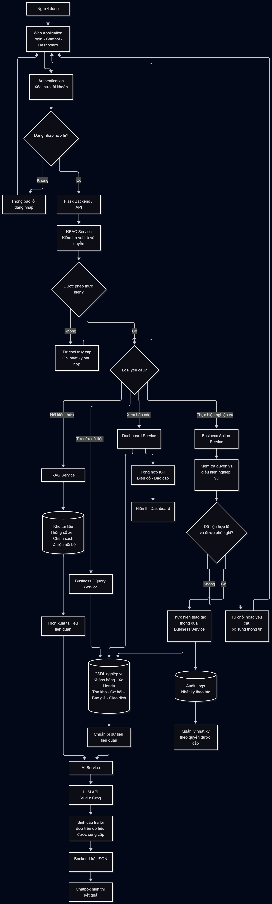

# Thiet ke luong AI Chatbot Doanh Nghiep

## 1. Luong hoi dap co kiem soat quyen

```text
Nguoi dung -> UI/Flask API -> session
           -> intent + v_user_permissions
           -> audit allowed/denied
           -> SQL an toan hoac RAG theo quyen
           -> context co nguon -> Groq LLM
           -> chat_sessions/chat_messages -> UI
```

Neu bi tu choi, he thong tra loi chung chung, khong xac nhan du lieu co ton tai va khong truy xuat tiep.

## 2. Luong text-to-SQL

1. Xac dinh intent du lieu va kiem tra quyen truoc truy xuat.
2. Tao schema context tu `information_schema` va comment cua view `v_ai_*`.
3. Hieu tu dong nghia: `xe ga` -> `tay_ga`, `xe so` -> `xe_so`, `xe con` -> `con_tay`; don vi tien te VNĐ.
4. Validator chi cho mot cau `SELECT`, view whitelist, khong comment/`;` chen giua/`SLEEP`/`INTO OUTFILE`.
5. Tu them `LIMIT` toi da 100 va `MAX_EXECUTION_TIME`.
6. Chay bang `chatbot_ro`; loc `scope_branch_id` neu can.
7. Ghi audit va tra context; khong dua `password_hash` hoac `cost_price` trai quyen vao context.

View chinh: `v_ai_products`, `v_ai_inventory`, `v_ai_customers`, `v_ai_orders`; `v_ai_product_costs` chi danh cho `price:cost:read`.

## 3. Luong RAG va tai lieu

1. Kiem tra `v_user_kb_access`; guest chi thay danh muc public.
2. Tai lieu di qua parser/OCR, chunking/embedding va index.
3. Truy xuat top-k trong pham vi duoc phep, giu id/tieu de/trang/doan.
4. LLM chi tra loi bang bang chung; khong co bang chung thi noi ro khong tim thay.
5. Ghi session va message moi luot hoi.

## 4. Luong AI nhap du lieu

```text
Upload PDF/DOCX/XLSX/anh -> kiem tra file -> parser/OCR
-> chuan hoa schema -> preview/canh bao
-> nguoi co quyen sua/xac nhan -> ghi DB + log + nguon
```

AI khong duoc ghi thang du lieu nghiep vu chua xac nhan.

## 5. Pham vi 6 module

- CRM: khach hang theo quyen.
- Warehouse: ton kho theo san pham/chi nhanh.
- Opportunity: chi trien khai khi schema nghiep vu duoc chot.
- Quote: thao tac ghi phai co quyen va xac nhan.
- Dashboard: thong ke tu du lieu da kiem soat.
- AI Chat/RAG: dinh tuyen, truy xuat, sinh cau tra loi va nguon.

## 6. Tieu chi nghiem thu

- Khong goi API hoac doc du lieu ngoai quyen.
- Tai lieu da dinh dang co thong bao loi phu hop.
- Du lieu trich xuat qua preview-confirm-save.
- RAG co nguon va co ca khong tim thay bang chung.
- 6 module co it nhat mot luong end-to-end sau nang cap.

