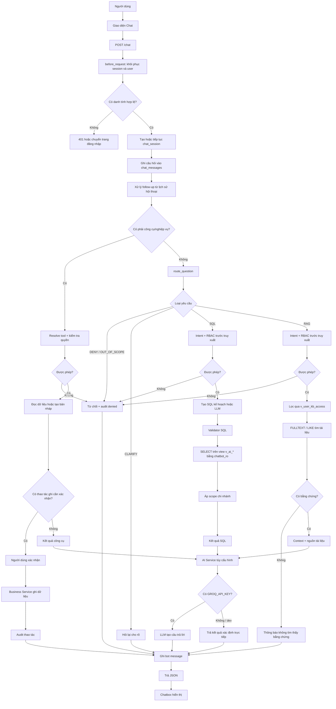

# Luồng xử lý dữ liệu runtime của chatbot

Tài liệu này mô tả luồng đang chạy thật của chatbot Flask sau khi người dùng gửi câu hỏi tại endpoint `POST /chat`.

## 1. Sơ đồ tổng quát



## 2. Thứ tự xử lý thật

### Bước 1: Nhận request

Endpoint chính là `POST /chat` trong `app.py`.

Backend kiểm tra:

- Payload phải có trường `question` dạng chuỗi.
- Câu hỏi không được rỗng.
- Độ dài tối đa là 4.000 ký tự.
- CSRF và session được kiểm tra ở `before_request`.

### Bước 2: Xác định danh tính

`security.initialize_request()` lấy user từ session đăng nhập server-side.

Trong môi trường dev, có thể dùng:

```http
X-Demo-User-Id: 3
```

Header này chỉ được chấp nhận khi:

```text
APP_ENV=dev
```

Production không dùng header giả lập; danh tính chỉ lấy từ session đăng nhập.

Nếu không có user hợp lệ, request bị từ chối hoặc chuyển đến trang đăng nhập tùy loại request.

### Bước 3: Tạo phiên hội thoại

Backend:

1. Tiếp tục `chat_session_id` cũ nếu thuộc đúng user hiện tại.
2. Nếu không có, tạo dòng mới trong `chat_sessions`.
3. Đọc tối đa 10 message gần nhất.
4. Xử lý câu hỏi follow-up.
5. Ghi câu hỏi user vào `chat_messages`.

### Bước 4: Xử lý công cụ nghiệp vụ

Trước khi vào SQL/RAG, backend thử nhận diện các tool nghiệp vụ như:

- Tra cứu tồn kho.
- Tra cứu khách hàng.
- Tạo bản nháp khách hàng.
- Nhập dữ liệu.
- Đặt lịch.
- Các thao tác nghiệp vụ khác được khai báo trong `chat_tools.py`.

Tool phải:

1. Được resolve từ catalog tool được phép.
2. Kiểm tra quyền qua `chatbot_intents` và `v_user_permissions`.
3. Kiểm tra scope chi nhánh hoặc scope user.
4. Nếu là thao tác ghi, tạo bản nháp.
5. Chỉ ghi dữ liệu sau khi người dùng xác nhận.
6. Ghi audit cho thao tác bị từ chối hoặc đã thực hiện.

LLM không được tự chạy SQL hoặc tự ghi trực tiếp vào database trong nhánh tool.

### Bước 5: Phân loại câu hỏi

Nếu không phải tool, backend gọi `route_question()`.

Các kết quả chính:

| Loại | Xử lý |
|---|---|
| `SQL` | Tra cứu dữ liệu có cấu trúc |
| `RAG` | Tìm tài liệu/chính sách/quy trình |
| `CLARIFY` | Hỏi lại vì câu hỏi chưa rõ |
| `DENY` | Từ chối yêu cầu nguy hiểm hoặc vượt quyền |
| `OUT_OF_SCOPE` | Từ chối yêu cầu ngoài phạm vi chatbot |

`DENY` và `OUT_OF_SCOPE` dừng ngay tại router, không chạy SQL và không tìm RAG.

### Bước 6A: Nhánh SQL

Luồng SQL thực tế:

```text
Câu hỏi
  -> detect intent
  -> authorize_intent
  -> lấy view được phép
  -> plan_query hoặc generate_query
  -> validate_sql
  -> chạy bằng chatbot_ro
  -> áp scope chi nhánh
  -> trả QueryEvidence
```

Các intent SQL hiện có gồm nhóm:

- `ask_price_list`
- `ask_stock`
- `ask_customer_info`
- `ask_order_status`
- `ask_cost_margin`

View AI được phép dùng:

- `v_ai_products`
- `v_ai_inventory`
- `v_ai_customers`
- `v_ai_orders`
- `v_ai_product_costs`

`v_ai_product_costs` chỉ được đưa vào whitelist khi user có quyền `price:cost:read`.

Validator SQL bắt buộc:

- Chỉ đúng một statement.
- Chỉ `SELECT` hoặc `UNION SELECT` hợp lệ.
- Chỉ truy cập view trong whitelist.
- Chặn bảng gốc và `information_schema`.
- Chặn comment.
- Chặn `DROP`, `UPDATE`, `DELETE`, `INSERT`, `INTO OUTFILE`.
- Chặn `SLEEP`, `BENCHMARK`, `GET_LOCK` và hàm nguy hiểm.
- Tự giới hạn tối đa 100 dòng.
- Đặt timeout tối đa 5 giây.

Kết nối thực thi SQL dùng:

```text
CHATBOT_RO_USER=chatbot_ro
CHATBOT_RO_PASSWORD=<đọc từ .env>
```

### Bước 6B: Nhánh RAG

Luồng RAG thực tế:

```text
Câu hỏi đã xử lý follow-up
  -> detect intent
  -> authorize_intent
  -> lọc tài liệu theo user
  -> FULLTEXT hoặc LIKE fallback
  -> xếp hạng tài liệu
  -> trả tối đa 3 nguồn
```

User đăng nhập chỉ được xem tài liệu nằm trong `v_user_kb_access`.

Guest chỉ được xem tài liệu public.

Mỗi nguồn trả về gồm:

```text
[Nguồn id=<id> | tiêu đề=<title>]
```

Nếu không có tài liệu phù hợp, chatbot trả lời rõ là không tìm thấy bằng chứng được phép truy cập và không tự bịa nội dung.

### Bước 7: Gọi LLM hoặc trả kết quả trực tiếp

Nếu có `GROQ_API_KEY`, context đã được kiểm soát mới được gửi cho LLM để diễn đạt câu trả lời.

Nếu không có API key hoặc đang ở `APP_ENV=dev`, backend có thể trả kết quả SQL/RAG trực tiếp mà không gọi LLM.

Các kết quả bị từ chối hoặc không có bằng chứng không được gửi cho LLM.

### Bước 8: Ghi lịch sử và trả response

Backend ghi câu trả lời bot vào `chat_messages`, sau đó trả JSON gồm các trường chính:

```json
{
  "answer": "...",
  "type": "SQL hoặc RAG",
  "module": "...",
  "session_id": 123,
  "engine": "database hoặc groq",
  "access_denied": false,
  "rows": [],
  "summary": null,
  "sources": []
}
```

## 3. Các điểm bảo mật quan trọng

- Không lấy user từ ô chọn tài khoản trên giao diện.
- Không tin tưởng quyền do frontend gửi lên.
- Không cho LLM tự tạo ID hoặc tự ghi dữ liệu.
- Không gửi `password_hash` vào view AI.
- Không đưa `cost_price` vào context nếu chưa có quyền.
- Không thực thi SQL trước khi kiểm tra intent và quyền.
- Không tìm tài liệu ngoài tập tài liệu được cấp quyền.
- Mọi thao tác ghi phải có kiểm tra điều kiện và xác nhận phù hợp.
- Yêu cầu `DENY` hoặc `OUT_OF_SCOPE` phải dừng trước SQL/RAG.

## 4. Phạm vi của sơ đồ này

Sơ đồ này mô tả luồng chatbot tại `POST /chat`.

Các API dashboard, quản trị user, upload tài liệu và đồng bộ Excel là các luồng riêng; chúng không đi qua cùng một pipeline hỏi đáp SQL/RAG ở trên.